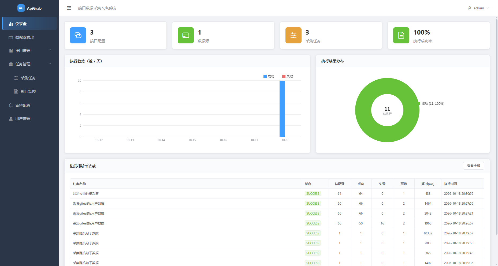
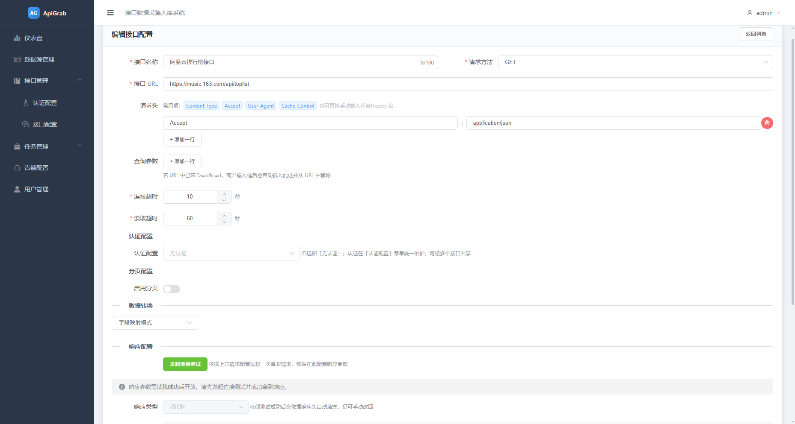
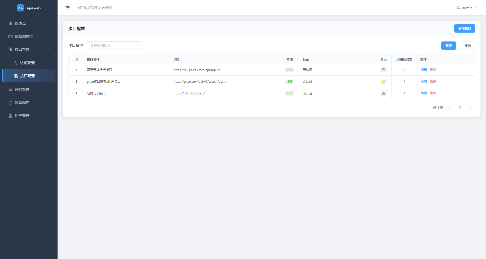
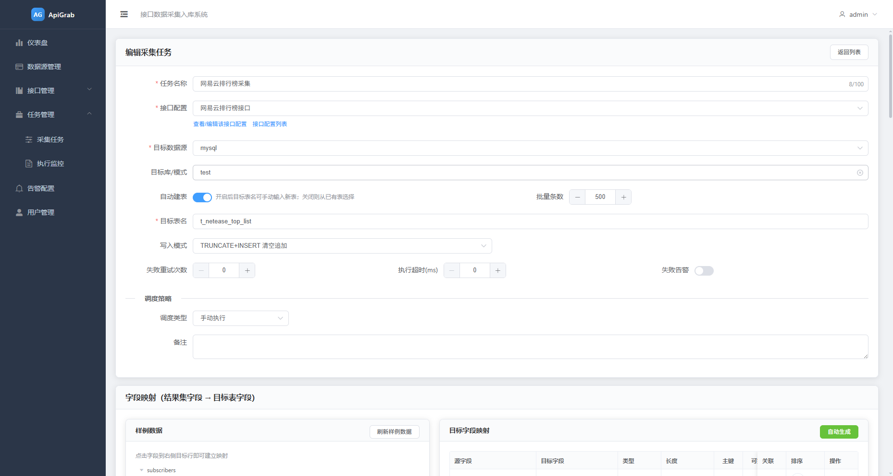
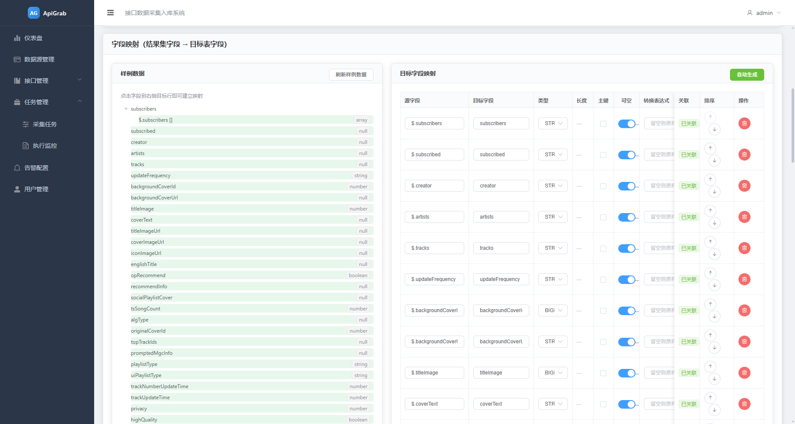
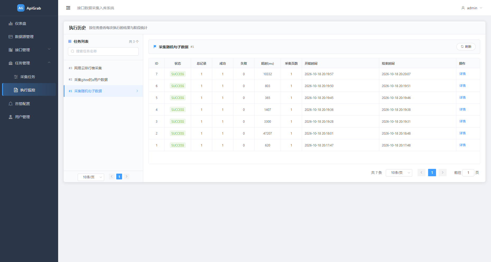
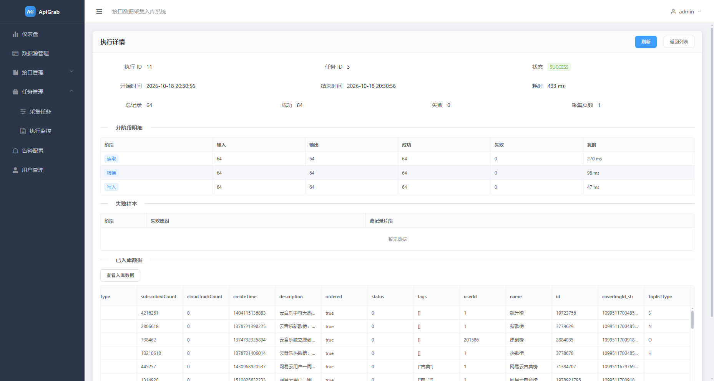

# ApiGrab

## 一、工具介绍

### 1、功能描述

一句话，API Grab 是一套通用的**接口数据采集入库**工具：通过图形配置化方式对接各类 RESTful API（JSON / XML / NDJSON 响应），按需拉取、解析、转换数据，并按指定策略写入目标数据库，同时提供任务调度、执行监控与失败告警能力。包括：

- **配置化采集**

支持接口配置、认证、分页拉取、字段映射与目标库写入的全流程配置化，无需编写代码即可完成接口数据的采集。

- **多认证适配**

支持无认证、Basic、Bearer、OAuth2、自定义 Header、账号密码换 Token 等多种认证方式，且认证配置可在多个接口间复用。

- **多数据库写入**

运行期动态管理 MySQL / Oracle / SQL Server / PostgreSQL 以及达梦、人大金仓、神通、GBase8A、瀚高、openGauss、OceanBase、优炫 UXDB 等国产库目标数据源，支持自动建表、INSERT / MERGE / TRUNCATE_INSERT 多种写入模式。

- **可观测执行**

采集过程分阶段（READ / DETAIL / TRANSFORM / WRITE）记录进度、统计与失败样本，支持执行历史回溯与入库数据预览。

- **稳定容错**

支持失败重试、执行超时、按批写入、分页节流、失败告警与部分成功统计。

- **灵活转换**

支持字段映射与内置转换函数，并支持 Groovy 脚本完成复杂数据处理与聚合。

### 2、结构设计

- 模块结构功能

```
└── apigrab
    ├── apigrab-common                  // 公共模块：统一响应体、异常体系、通用工具
    ├── apigrab-persistence             // 持久化层：MyBatis 实体/枚举/TypeHandler/DAO 与映射
    ├── apigrab-core                    // 核心采集引擎：HTTP、解析、认证、字段映射、动态数据源、告警
    ├── apigrab-admin                   // 管理后台与应用入口：Controller、Service、Quartz 调度、Flyway 迁移
    ├── apigrab-web-ui                  // 基于 Vue2 + Element UI 的前端交互页面（独立于 Maven 构建）
    └── apigrab-dist                    // 基于 maven-assembly-plugin 插件的发行包打包模块
```

模块依赖方向：`admin → core → persistence → common`。

> 功能与架构的完整说明见 [docs/apigrab_function_document.md](docs/apigrab_function_document.md)。

## 二、编译打包

本系统后端纯 Java 语言开发，前后端依赖均来自开源项目。

### 1、编译打包

- 环境要求：

  **JDK**：>=1.8（建议用 JDK 1.8）

  **maven**：>=3.6

> Maven 仓库默认在国外，国内使用难免很慢，可以更换为阿里云的仓库。参考教程：[配置阿里云的仓库教程](https://www.runoob.com/maven/maven-repositories.html)

- 编译命令：

**(1) Windows 下：**

```
双击 build.cmd 脚本文件即可编译打包
```

**(2) Linux 下：**

```
git clone https://gitee.com/inrgihc/apigrab
cd apigrab/
sh ./build.sh
```

**(3) Docker 下：**

```
git clone https://gitee.com/inrgihc/apigrab
cd apigrab/
sh ./docker-maven-build.sh
```

### 2、安装部署

(1) 物理机部署

当编译打包命令执行完成后，会在 `apigrab/target/` 目录下生成 `apigrab-release-x.x.x.tar.gz` 的打包文件，将文件拷贝到已安装 JRE 的部署机器上解压即可。

(2) docker 容器方式部署：

镜像为： `registry.cn-hangzhou.aliyuncs.com/inrgihc/apigrab:latest`。

- H2做配置库部署

这里将宿主机的/tmp目录挂载到容器上：
```
docker run -d --name apigrab -e DBTYPE=h2 -v /tmp:/tmp -p 5880:5880 \
  registry.cn-hangzhou.aliyuncs.com/inrgihc/apigrab:latest
```

- MYSQL做配置库部署

假设已部署好的 MySQL(5.7+) 元数据库地址为 192.168.31.57，端口 3306，账号 test，密码 123456：

```
docker run -d --name apigrab \
 -e MYSQLDB_HOST=192.168.31.57 \
 -e MYSQLDB_PORT=3306 \
 -e MYSQLDB_USERNAME=test \
 -e MYSQLDB_PASSWORD='123456' \
 -e MYSQLDB_NAME='apigrab' \
 -p 5880:5880 \
 registry.cn-hangzhou.aliyuncs.com/inrgihc/apigrab:latest
```

(3) 基于 docker-compose 提供 linux 联网环境下的一键部署（自动拉起 MySQL 元数据库 + 应用）：

```
cd build-docker/install && docker-compose up -d
```

文档详见：[build-docker/install/README.md](build-docker/install/README.md)

## 三、系统使用

> ApiGrab 提供 WEB 图形界面配置使用方式。

### 1、准备元数据库

系统需要 MySQL(建议版本：5.7+) 或内置的 H2 (默认) 作为元数据库，用于存储接口/数据源/认证/任务/映射/执行/告警/用户等元数据。

### 2、配置 conf/application.yml

application.yml配置内容示例如下，支持mysql和h2作为配置元数据库。

```yaml
spring:
  application:
    name: apigrab
  profiles:
    include: h2
    #include: mysql
```

按照上述配置，只需修改```conf/application.yml```及```conf/application-???.yml```配置文件中的如下配置参数：

| 配置参数 | 配置说明 | 示例 |
| :------ | :------ | :------ |
| server.port | 服务监听端口 | 5880 |
| spring.profiles.include | 数据库配置类型 | mysql |
| spring.datasource.url | 元数据库 JDBC 连接串 | jdbc:mysql://192.168.31.57:3306/apigrab?... |
| spring.datasource.username | 元数据库连接账号 | root |
| spring.datasource.password | 元数据库连接密码 | 123456 |
| apigrab.http.insecure-tls | 采集请求是否跳过 TLS 证书校验（内网自签证书场景可开启，公网接口勿开） | true |

### 3、启动系统

- Linux 系统下：

```
cd apigrab-release-X.X.X/
bin/startup.sh
```

- Windows 系统下：

```
切换到 apigrab-release-X.X.X/bin/ 目录下，双击 startup.cmd 脚本文件即可启动
```

### 4、国产数据库支持

除 MySQL / Oracle / SQL Server / PostgreSQL 外，目标库还支持**达梦 DM、人大金仓 KingbaseES、神通 Oscar、南大通用 GBase8A、瀚高 HighGo、openGauss、OceanBase、优炫 UXDB**。

国产数据库 JDBC 驱动是厂商私有 jar，**不随 Maven 依赖打包，也不进入 `lib/` 的 classpath**。请按同作者项目 `dbswitch` / `sqlrest` 的目录约定放置（本仓库已随附常用版本）：

```
drivers/
├── dm/dm-8/DmJdbcDriver18.jar
├── kingbase/kingbase-v8r3/… , kingbase/kingbase-v8r6/… , kingbase/kingbase-v9r1/…
├── oscar/oscar-8/oscarJDBC8.jar
├── gbase8a/gbase8a-8.6/… , gbase8a/gbase8a-9.5/…
├── highgo/highgo-6.2.4/HgdbJdbc-6.2.4.jar
├── opengauss/opengauss-3.0.0/… , opengauss/opengauss-5.0.0/…
├── oceanbase/ob-2.4.3/oceanbase-client-2.4.3.jar
└── uxdb/uxdb-2.1.2.4a/uxdbjdbc-2.1.2.3p.jre8.jar
```

- 驱动根目录由 `apigrab.datasource.drivers-path` 配置（默认 `drivers`，可逗号分隔多个；发行包中位于 `apigrab-release-*/drivers/`，容器可用 `DRIVERS_PATH` 覆盖）。类型目录名必须与枚举名小写一致，版本子目录名任意；同一版本目录下的多个 jar 会一起加载（例如金仓 V9 的 `bcprov` 依赖）。
- 新增数据源时选择对应类型，表单自动填入驱动类与 JDBC URL 模板，并在「外部驱动」下拉中列出已扫描到的驱动包；选中即自动填写 `driverPath`。也可手工填写 jar 文件或其所在目录的绝对路径，多个用逗号分隔。
- 驱动类由隔离的 `URLClassLoader` 实例化并交给 Hikari 的 `DataSource`，不注册到全局 `DriverManager`，不同库/版本的驱动不会互相冲突；运行中放入新 jar 后点「刷新驱动」即可重新扫描。
- 方言按兼容族复用：达梦走 Oracle 系（DUAL / MERGE / ROWNUM），人大金仓 / 神通 / 瀚高 / openGauss / 优炫走 PostgreSQL 系，GBase8A / OceanBase（MySQL 模式）走 MySQL 系。OceanBase 的 Oracle 兼容模式租户请选用 `ORACLE` 类型配合 OceanBase 驱动。
- 元数据库仍只支持 MySQL / H2，与目标库类型无关。

### 5、WEB 使用

### 1、使用说明文档

- WEB 系统的访问如下：

> URL 地址：`http://127.0.0.1:5880`　登录账号：`admin`　登录密码：`123456`

注意：如果为服务器部署时，需要将 127.0.0.1 替换为服务器的 IP 地址。

- WEB 系统的使用流程为：

>  建立数据源连接 → 配置认证配置 → 配置接口配置（含分页、响应解析、详情补全） → 建立采集任务与字段映射 → 配置调度策略 → 手动/系统调度执行任务 → 查看执行监控与入库预览

- 工具使用手册：

[《APIGRAB工具使用说明文档》](https://www.kdocs.cn/l/cgK6GlO3RQ7n)

### 2、部分系统截图

 
 
 
 
 
 
 
 
 
 
 

 

## 四、常见问题解决

### 1、执行启动脚本报错

- （1）在 Windows 下，执行 startup.cmd 脚本报错

> 解决办法：将脚本的内容复制后，删除原脚本文件，然后再创建一个同名脚本文件后，将原内容粘贴进去后，再执行脚本。

- （2）在 Linux 下，执行 startup.sh 脚本报错

> 解决办法：用 vi/vim 工具打开脚本，然后命令模式下设置 `set ff=unix` 后，然后保存退出，再执行脚本。

### 2、启动后无法连接元数据库

> 确认 `conf/application.yml`（或容器环境变量）中的元数据库地址、端口、账号、密码正确，且目标库账号具有建库建表权限。

## 五、贡献参与

为了能让项目得到更好的可持续的发展，APIGrab期望获得更多的代码开发爱好者参与代码贡献，包括但不限于：

- 改进前端 UI/UX
- 修复 bug 和性能优化
- 增加新的易用性功能

贡献操作文档参考：[贡献说明指南](https://gitee.com/inrgihc/dbswitch/blob/master/CONTRIBUTE.md)

## 五、项目推荐

[1].开源的数据库迁移同步工具dbswitch:[https://gitee.com/inrgihc/dbswitch](https://gitee.com/inrgihc/dbswitch)

[2].开源的RESTful接口开发(SQL2API)工具SQLREST:[https://gitee.com/inrgihc/sqlrest](https://gitee.com/inrgihc/sqlrest)

[3].开源的接口数据采集入库(API2DB)工具APIGrab:[https://gitee.com/inrgihc/apigrab](https://gitee.com/inrgihc/apigrab)

## 六、问题反馈

如果您看到并使用了本工具，或您觉得本工具对您有价值，请为此项目**点个赞**，以表示对本项目的支持，多谢！如果您在使用时遇到了bug，欢迎在issue中反馈。

